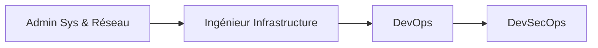

<h1 align="center">⚙️ Cheikh Ahmadou Bamba Ndour</h1>

<p align="center">
  
</p>

<p align="center">
  
  
  
  <a href="https://www.linkedin.com/in/cheikh-ahmadou-bamba-ndour">
    
  </a>
</p>

---

## 🖥️ `whoami`

```bash
$ whoami
bamba

$ cat profil.txt
role        : Admin Sys & Réseau → Ingénieur Infra → DevOps → DevSecOps
formation   : Master 2 Administration des Réseaux et Systèmes Informatiques
localisation: Dakar, Sénégal
mode        : apprentissage par la pratique (1 notion = 1 lab)

$ ./status.sh
[OK] Linux ........... en cours
[..] Docker .......... à venir
[..] Kubernetes ...... à venir
[..] Terraform ....... à venir
```

> Chaque notion est testée en lab, puis documentée avec ce qui a fonctionné et ce qui a planté.

---

## 🧰 Stack ciblée

<p align="center">
  
</p>
<p align="center">
  
</p>

---

## 📂 Dépôts

| Dépôt | Description |
|---|---|
| 📓 [learning-journal](https://github.com/BambaNdour96/learning-journal) | Mes labs, un par un |

---

## 🧭 Trajectoire



---

## 🎓 Certifications : feuille de route

Statuts : 🎯 Objectif · 📚 En préparation · ✅ Obtenue

### 🐧 Phase 1 : Fondations systèmes et réseau
| Domaine | Certification | Statut |
|---|---|---|
| Linux | RHCSA (ou LFCS) | 🎯 |
| Réseau | CCNA | 🎯 |
| Anglais | TOEIC | 🎯 |

### 🏢 Phase 2 : Infrastructure d'entreprise
| Domaine | Certification | Statut |
|---|---|---|
| Automatisation Linux | RHCE (Ansible) | 🎯 |
| Microsoft : cloud | AZ-104 Azure Administrator | 🎯 |
| Microsoft : serveurs | AZ-800 / AZ-801 Windows Server Hybrid | 🎯 |
| Virtualisation | VMware VCP-DCV | 🎯 |

### ☁️ Phase 3 : Cloud et DevOps
| Domaine | Certification | Statut |
|---|---|---|
| Cloud AWS | Solutions Architect Associate | 🎯 |
| Infrastructure as Code | Terraform Associate | 🎯 |
| Conteneurs | CKA | 🎯 |
| DevOps avancé | AWS DevOps Engineer Professional | 🎯 |

### 🔐 Phase 4 : Sécurité
| Domaine | Certification | Statut |
|---|---|---|
| Sécurité générale | Security+ | 🎯 |
| Sécurité Kubernetes | CKS | 🎯 |
| DevSecOps | Certified DevSecOps Professional | 🎯 |

---

## 📫 Contact

<p align="center">
  <a href="https://www.linkedin.com/in/cheikh-ahmadou-bamba-ndour">
    
  </a>
</p>

<p align="center"><i>$ echo "Toujours en train d'apprendre, toujours en train de construire."</i></p>
