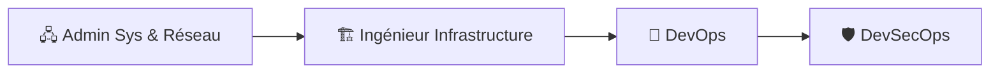

<h1 align="center">⚙️ Cheikh Ahmadou Bamba Ndour</h1>

<p align="center">
  
</p>

<p align="center">
  
  
  
  <a href="https://www.linkedin.com/in/cheikh-ahmadou-bamba-ndour">
    
  </a>
</p>

---

## 🖥️ `whoami`

```bash
$ whoami
bamba

$ cat profil.txt
trajectoire : Admin Sys & Réseau → Ingénieur Infra → DevOps → DevSecOps
formation   : Master 2 Administration des Réseaux et Systèmes Informatiques
localisation: Dakar, Sénégal
méthode     : 1 notion = 1 lab = 1 fichier documenté (ce qui marche + ce qui plante)

$ ./status.sh
[..] Linux & Bash ............ en cours
[..] Réseau (TCP/IP, VLAN) ... en cours
[..] Windows Server & AD ..... à venir
[..] Docker .................. à venir
[..] Kubernetes .............. à venir
[..] Terraform & Ansible ..... à venir
[..] CI/CD ................... à venir
[..] Observabilité ........... à venir
[..] DevSecOps ............... à venir
```

> Les outils ci-dessous sont mon **périmètre cible**. Je ne les marque comme maîtrisés qu'avec un lab ou un projet public à l'appui, dans [learning-journal](https://github.com/BambaNdour96/learning-journal).

**Légende :** 🎯 Objectif · 📚 En cours · ✅ Maîtrisé (preuve dans un dépôt)

---

## 🧭 Trajectoire



---

## 🧰 Stack complète

### 🐧 1. Administration Systèmes


### 🌐 2. Réseau


### 🖧 3. Virtualisation & Stockage


### ☁️ 4. Cloud


### 🏗️ 5. Infrastructure as Code & Configuration


### 🐳 6. Conteneurs & Orchestration


### 🔁 7. CI/CD & GitOps


### 📊 8. Observabilité & Logs


### 🛡️ 9. DevSecOps & Cybersécurité


### 💻 10. Langages & Outils transverses


---

## 🗺️ Parcours d'apprentissage

Cases cochées au fur et à mesure, chacune avec un lab dans [learning-journal](https://github.com/BambaNdour96/learning-journal).

### Niveau 1 : Admin Sys & Réseau
- [ ] Linux : utilisateurs, permissions, processus, systemd, logs
- [ ] Bash : scripts, cron, automatisation de tâches
- [ ] Réseau : TCP/IP, sous-réseaux, VLAN, routage, NAT
- [ ] Services : DNS, DHCP, Nginx, reverse proxy, VPN WireGuard
- [ ] Stockage : LVM, RAID, sauvegardes
- [ ] Windows Server : Active Directory, GPO, DNS/DHCP
- [ ] Sécurité de base : firewall, SSH durci, fail2ban

### Niveau 2 : Ingénieur Infrastructure
- [ ] Virtualisation : Proxmox / KVM, templates, réseau virtuel
- [ ] Automatisation : Ansible (rôles, playbooks, inventaires)
- [ ] Cloud : AWS (IAM, VPC, EC2, S3) et Azure (bases)
- [ ] Haute disponibilité, sauvegarde et reprise d'activité
- [ ] Supervision : Zabbix ou Prometheus + Grafana

### Niveau 3 : DevOps
- [ ] Git avancé et workflows
- [ ] Docker, Compose, images optimisées
- [ ] Kubernetes : déploiements, services, Ingress, Helm
- [ ] Terraform : modules, state distant, environnements
- [ ] CI/CD : GitLab CI et GitHub Actions
- [ ] GitOps : ArgoCD
- [ ] Observabilité : Prometheus, Grafana, ELK, OpenTelemetry

### Niveau 4 : DevSecOps
- [ ] Scan d'images et de dépendances (Trivy)
- [ ] SAST / DAST dans les pipelines
- [ ] Gestion des secrets (Vault)
- [ ] Sécurité Kubernetes : RBAC, Network Policies, OPA/Kyverno, Falco
- [ ] Durcissement et conformité (CIS Benchmarks)
- [ ] Détection et réponse à incident (SIEM, logs)

---

## 📂 Dépôts

| Dépôt | Description |
|---|---|
| 📓 [learning-journal](https://github.com/BambaNdour96/learning-journal) | Mes labs, un par un |
| 🏠 `homelab-infra` | À venir : réseau segmenté, serveurs, services |
| 🏗️ `iac-terraform-ansible` | À venir : infrastructure déployée par le code |
| 🔐 `k8s-devsecops-pipeline` | À venir : CI/CD sécurisée sur Kubernetes |
| 📊 `observability-stack` | À venir : Prometheus, Grafana, ELK |

---

## 🎓 Certifications : feuille de route

Statuts : 🎯 Objectif · 📚 En préparation · ✅ Obtenue

### 🐧 Phase 1 : Fondations systèmes et réseau
| Domaine | Certification | Statut |
|---|---|---|
| Linux | RHCSA (ou LFCS) | 🎯 |
| Réseau | CCNA | 🎯 |
| Anglais | TOEIC | 🎯 |

### 🏢 Phase 2 : Infrastructure d'entreprise
| Domaine | Certification | Statut |
|---|---|---|
| Automatisation Linux | RHCE (Ansible) | 🎯 |
| Microsoft : cloud | AZ-104 Azure Administrator | 🎯 |
| Microsoft : serveurs | AZ-800 / AZ-801 Windows Server Hybrid | 🎯 |
| Virtualisation | VMware VCP-DCV | 🎯 |

### ☁️ Phase 3 : Cloud et DevOps
| Domaine | Certification | Statut |
|---|---|---|
| Cloud AWS | Solutions Architect Associate | 🎯 |
| Infrastructure as Code | Terraform Associate | 🎯 |
| Conteneurs | CKA | 🎯 |
| DevOps avancé | AWS DevOps Engineer Professional | 🎯 |

### 🔐 Phase 4 : Sécurité
| Domaine | Certification | Statut |
|---|---|---|
| Sécurité générale | Security+ | 🎯 |
| Sécurité Kubernetes | CKS | 🎯 |
| DevSecOps | Certified DevSecOps Professional | 🎯 |

---

## 📚 Sources d'apprentissage

Labs de [stephane-robert.info](https://www.stephane-robert.info/docs/) · [roadmap.sh](https://roadmap.sh) · documentation officielle · KodeKloud · TryHackMe

---

## 📫 Contact

<p align="center">
  <a href="https://www.linkedin.com/in/cheikh-ahmadou-bamba-ndour">
    
  </a>
</p>

<p align="center"><i>$ echo "Toujours en train d'apprendre, toujours en train de construire."</i></p>
